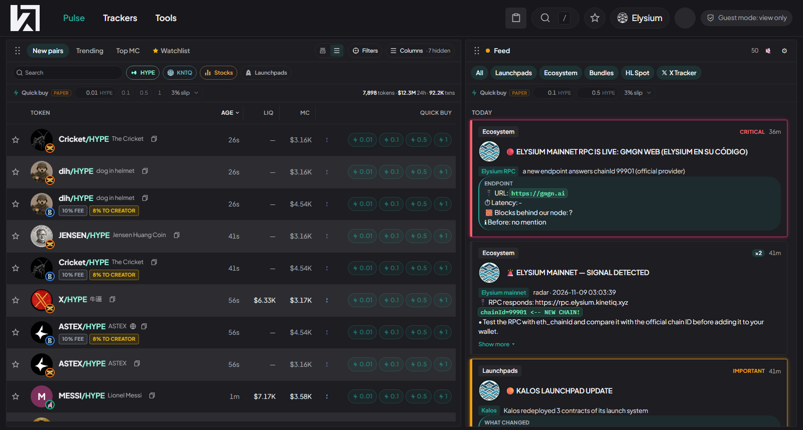
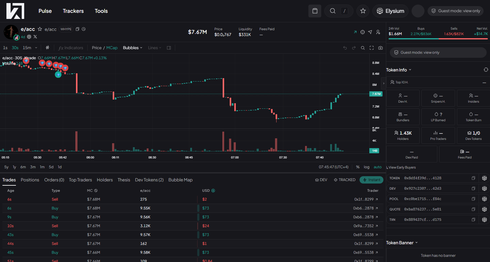
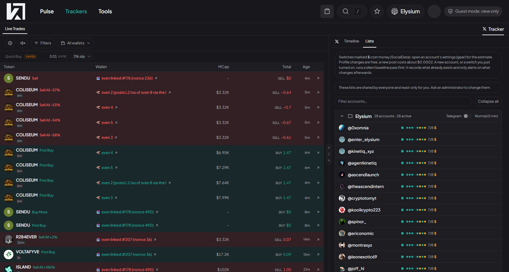
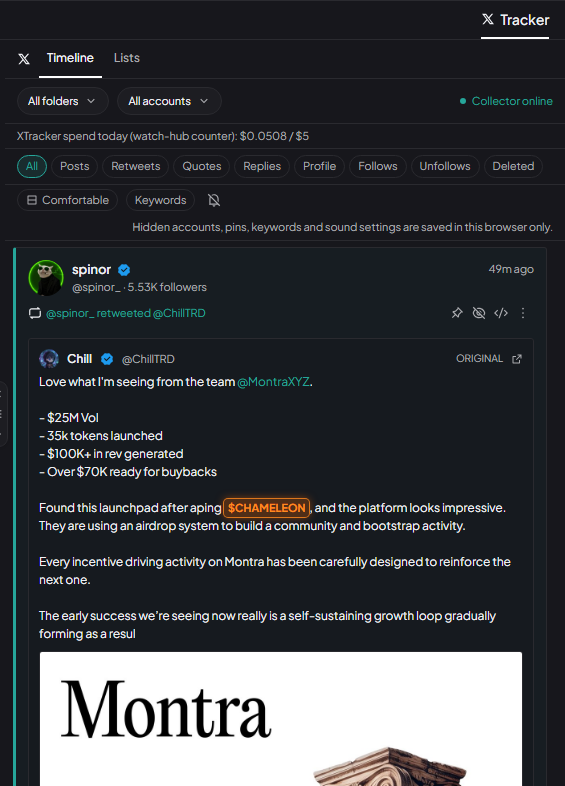
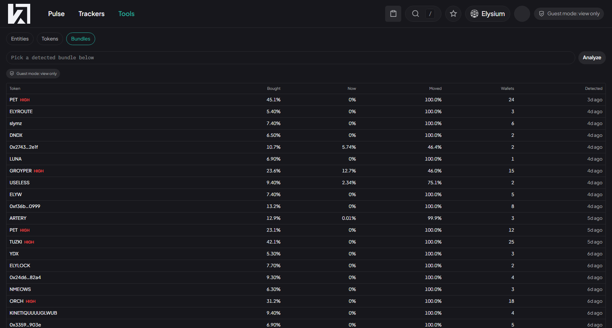

# Ktrade

A web trading terminal for Elysium, the HyperEVM L2. I designed it, built it and run it. It has been live with real trading since November 2026. I use it daily, and partners can try it through a read-only guest mode.

This repository is a showcase. The code is private because the product holds wallet custody. A read-only guest demo is available on request.

## What a trader can do

- **Find tokens.** Pulse lists new pairs and trending tokens with filters by liquidity, market cap and launchpad. Each row shows the launchpad, fees and bundle flags at a glance.
- **Read a token.** The token page has the chart, trades, holders, top traders and key addresses in one view.
- **Act on signals.** A live feed carries launch, bundle and tracked-wallet alerts. Each one leads to a one-tap buy, so the trader doesn't have to leave the page.
- **Track wallets.** Follow wallets and see their trades as they happen, with buy and sell signals, PnL on exits and a quick-buy row.
- **Follow X accounts.** An X tracker groups accounts into folders and shows a timeline of posts, retweets, follows and deletions, so news reaches the trader next to the trades.
- **Spot bundles.** A tool lists tokens where a group of wallets bought a large share at launch. Opening one draws a graph of who funded whom, who still holds, who is selling and who has sold. It also states that funding links are evidence of a common source and not proof of ownership.
- **Manage positions.** A portfolio with custodial wallets, a bridge from HyperEVM and an exchange view. It is only visible to the owner, so there is no screenshot here.

## Product decisions

- **Phased rollout.** Read-only first, then paper trading, then real execution for one user with limits, then more venues one at a time.
- **Safety before speed.** Every order is simulated on-chain before it is sent. Spending caps per order and per day, a kill switch, and a closed list of supported venues. New venues are built switched off, validated in simulation and reviewed, and only then turned on for a small real test.
- **Speed where it matters.** I measured the order-submission path across several RPC routes and switched to the fastest, cutting send time from roughly 7-20 seconds to 1-2 seconds.
- **Showing the product safely.** A read-only guest mode lets partners use the live terminal without any trading access.

## How it's built

TypeScript monorepo: a Fastify API with SQLite and a Next.js web app, deployed with Docker behind a Cloudflare tunnel. Market data comes from an indexer that reads the chain and from alert feeds I run separately.
